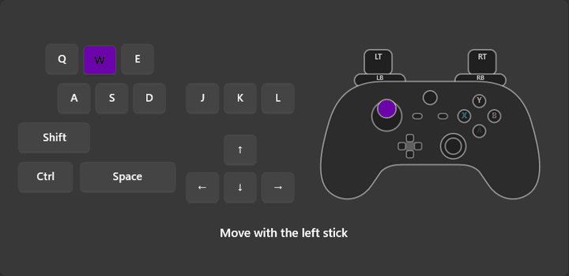
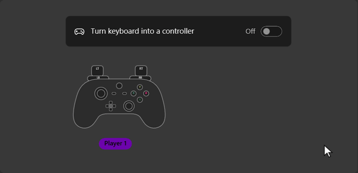
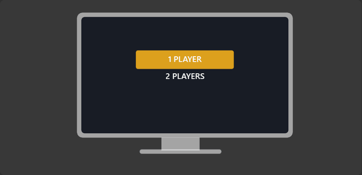
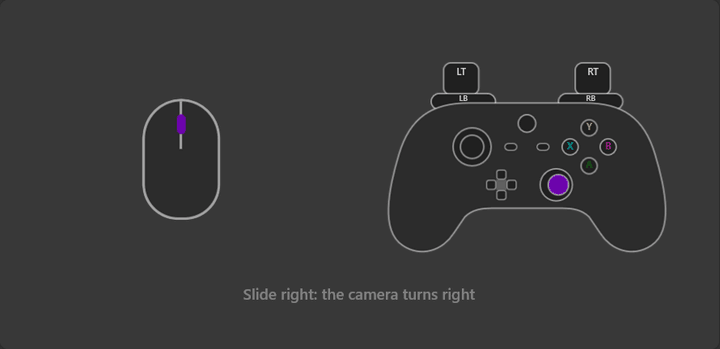
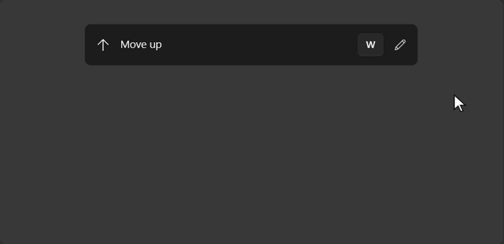
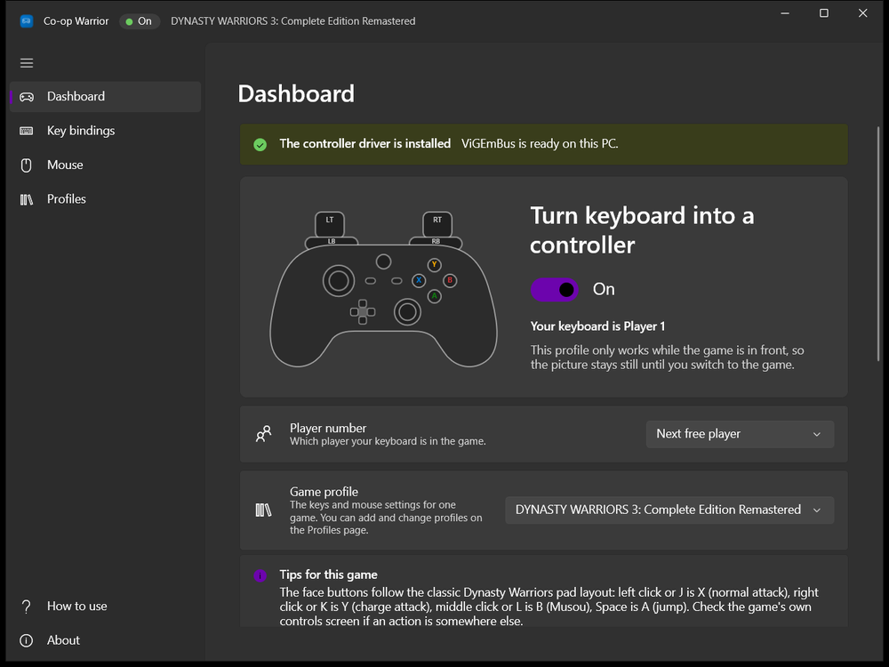
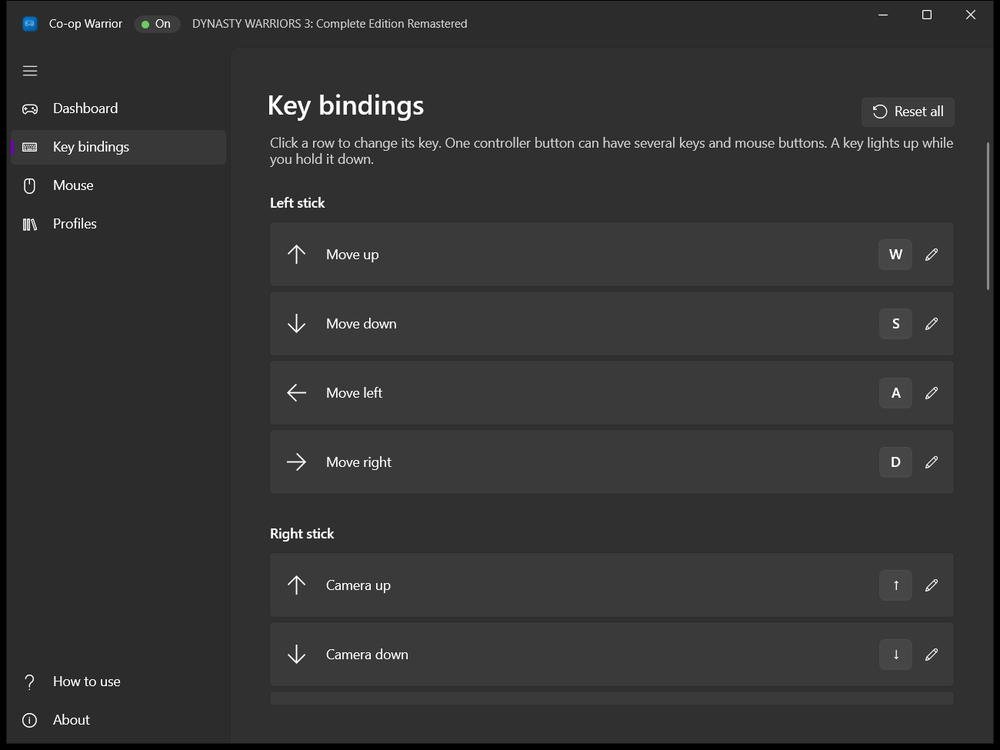
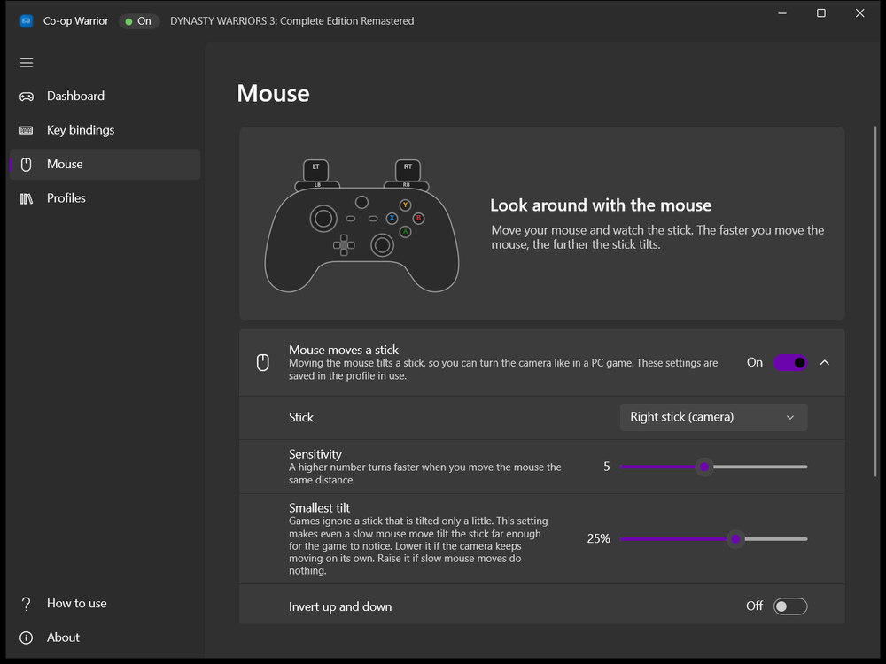
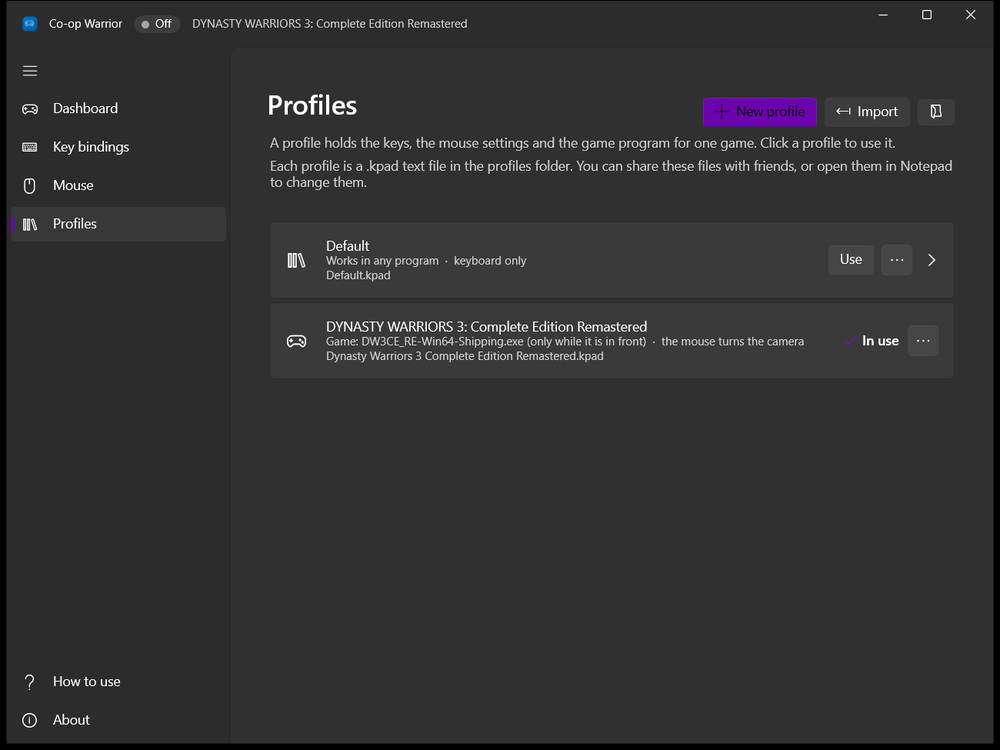

<div align="center">


# Co-op Warrior

**Play split-screen games with one controller and a keyboard.**

Co-op Warrior turns your keyboard and mouse into an Xbox controller,
so one more person can join a local co-op game.

[](#install)
[](#build-from-source)
[](LICENSE)
[](https://github.com/Mohamed-Effat/CoopWarrior/releases/latest)

[**Download for Windows**](https://github.com/Mohamed-Effat/CoopWarrior/releases/latest/download/CoopWarrior-win-Setup.exe) ·
[How to use](#how-to-use) ·
[Default keys](#default-keys) ·
[Problems](#if-something-goes-wrong)

<br />



</div>

## Why it exists

Some local co-op games treat the keyboard and mouse and the first controller you connect as the same
player: Player 1. Both control the same character. So with one controller and a keyboard,
two people cannot play. The only way to get a Player 2 is to use a second controller.

Co-op Warrior fixes that. It makes your keyboard and mouse act as a **virtual controller**: Windows sees
one more Xbox 360 controller, and your keyboard and mouse drive it. The game now has two controllers,
so it gives each one its own player.

## Features

- **One switch.** Turn the keyboard into a controller from the Dashboard, and turn it off again
  with one key (F12).
- **Choose the player number.** Make the keyboard Player 1, 2, 3 or 4, or let it take the next free number.
- **Change any key.** Every controller button can use any key, and several keys at once.
  Mouse buttons work too.
- **Look around with the mouse.** Moving the mouse can tilt a stick, so you turn the camera
  like in a PC game.
- **Profiles for each game.** A **profile** holds the keys and mouse settings for one game.
  Profiles are small text files that you can share. A profile for
  DYNASTY WARRIORS 3: Complete Edition Remastered is included.
- **Only while the game is in front.** A profile can be limited to one game. When you switch to another
  window, your keys work as normal keys again.
- **Live preview.** The Dashboard draws your keyboard and its controller: the keys you press light up
  and the controller moves with them. It also shows the other controllers Windows sees, each with its player number.
- **Out of the way.** Minimizing or closing the window keeps Co-op Warrior running next to the clock,
  where a right-click turns the keyboard controller on or off.
- **Easy to install.** The installer needs no admin rights, and the app updates itself from GitHub.
- **A built-in guide.** The first time you start the app, a short animated guide walks you through it.

## Install

You need 64-bit Windows 10 (version 1809 or newer) or Windows 11.

1. Download [**CoopWarrior-win-Setup.exe**](https://github.com/Mohamed-Effat/CoopWarrior/releases/latest/download/CoopWarrior-win-Setup.exe).
   The link always gives you the newest version.
2. Run it. It installs for your Windows user only, so it needs no admin rights.
   When it is done, Co-op Warrior opens by itself.

The installer is not code-signed yet. Because of that, Windows may show "Windows protected your PC".
Click **More info**, then **Run anyway**.

Co-op Warrior needs the free [ViGEmBus](https://github.com/nefarius/ViGEmBus) driver, which adds the
controller to Windows. The app includes the driver. If it is missing, the Dashboard shows a yellow
message with an **Install driver** button. You install it once on each PC, and Windows asks for
permission one time.

## See it in action

<table>
  <tr>
    <td width="50%" align="center">
      <br />
      <b>Turn it on</b><br />Windows sees one more controller.
    </td>
    <td width="50%" align="center">
      <br />
      <b>Play together</b><br />Choose two players in the game.
    </td>
  </tr>
  <tr>
    <td width="50%" align="center">
      <br />
      <b>Turn the camera with the mouse</b><br />Faster moves tilt the stick further.
    </td>
    <td width="50%" align="center">
      <br />
      <b>Change any key</b><br />Click a row, then press the new key.
    </td>
  </tr>
</table>

## Screenshots

<table>
  <tr>
    <td width="50%"></td>
    <td width="50%"></td>
  </tr>
  <tr>
    <td align="center"><b>Dashboard</b></td>
    <td align="center"><b>Key bindings</b></td>
  </tr>
  <tr>
    <td width="50%"></td>
    <td width="50%"></td>
  </tr>
  <tr>
    <td align="center"><b>Mouse</b></td>
    <td align="center"><b>Profiles</b></td>
  </tr>
</table>

## How to use

1. **Install the driver** if the Dashboard asks for it. The message turns green when the driver is ready.
2. **Choose the player number** on the Dashboard. If you choose "Next free player", connect your real
   controller first if it should be Player 1.
3. **Pick a profile** for your game under "Game profile".
4. **Turn on "Turn keyboard into a controller".** The dot at the top of the window turns green.
5. **Start the game** and choose a two-player or split-screen mode. Each player presses Start on their
   own controller to join. On the keyboard, Start is Enter.

When you are done, press **F12**, or right-click the Co-op Warrior icon next to the clock and choose **Exit**.
The keyboard controller disappears from Windows. Closing or minimizing the window only hides it next to the clock,
and the keyboard controller keeps working; you can change that on the Settings page.
To type normally in between, press **F9** to pause, and press it again to resume.

## Default keys

| Controller | Keyboard and mouse |
| --- | --- |
| Left stick (move) | W A S D |
| Right stick (camera) | Arrow keys, or the mouse when "Mouse moves a stick" is on |
| A | Space |
| B | L or middle click |
| X | J or left click |
| Y | K or right click |
| LB and RB | Q and E |
| LT and RT | Shift and Ctrl |
| D-pad | T F G H |
| Left and right stick click | Z and X |
| Start and Back | Enter and Tab |
| Pause or resume | F9 |
| Turn off | F12 |

You can change all of them on the Key bindings page. Changes are saved in the profile in use.

## Profiles

Each profile is a `.kpad` text file. You can open one in Notepad, share it with a friend,
or import one on the Profiles page. A profile looks like this:

```ini
Name = My game
GameProcess = MyGame-Win64-Shipping
OnlyInGame = 1
Note = A tip shown on the Dashboard
MoveUp = W
A = Space, MButton
MouseStick = Right
MouseSensitivity = 5
```

`GameProcess` is the game's program name without `.exe`. With `OnlyInGame = 1`, the keys only work
while that program is in front. Lines that Co-op Warrior does not know are skipped, and any setting
you leave out keeps its default.

## If something goes wrong

| Problem | What to do |
| --- | --- |
| Both controllers move the same player | Turn off Steam Input for the game: in Steam, right-click the game > Properties > Controller > Disable Steam Input. |
| The game does not see the keyboard controller | Turn it on before you start the game. |
| The keyboard got a different player number than you chose | Another controller already has that number. Disconnect it, then turn the keyboard controller off and on again. |
| Your keys also do things in the game by themselves | Some games read the keyboard and mouse directly and give them to Player 1. Make the keyboard Player 1, or change Co-op Warrior's keys to keys the game does not use. |
| The camera turns too fast or too slow | Change "Sensitivity" on the Mouse page. |
| Malwarebytes flags `ViGEmBusSetup_x64.msi` as "Malware.AI" | This is a guess by its machine-learning scanner, not a known threat. The file is the official ViGEmBus driver installer, signed by Nefarius Software Solutions. Allow it or restore it from quarantine. Once the driver is installed, Co-op Warrior works without that file. |

## Build from source

You need the .NET 9 SDK.

```powershell
dotnet build src -c Release                        # compile check
.\tools\release\Release.ps1 -Version 2.1.0         # installer and update packages in releases\
Build.bat                                          # portable folder in dist\CoopWarrior (no automatic updates)
```

See [docs/releasing.md](docs/releasing.md) to publish a release, and [docs/](docs/README.md) to learn
how the app works.

Co-op Warrior is built with:

- [WinUI 3](https://github.com/microsoft/microsoft-ui-xaml) and the
  [Windows Community Toolkit](https://github.com/CommunityToolkit/Windows) for the app
- [ViGEmBus](https://github.com/nefarius/ViGEmBus) and ViGEmClient, from the
  [vgamepad](https://github.com/yannbouteiller/vgamepad) project, for the controller
- [Velopack](https://github.com/velopack/velopack) for the installer and updates

## License

Co-op Warrior is free software under the [GNU General Public License v3](LICENSE).
The license has an [added permission](LICENSE-EXCEPTION.txt) to combine it with Microsoft's
Windows App SDK, WinUI and .NET libraries.
The third-party software it includes, and the licenses for it, are listed in
[THIRD-PARTY-NOTICES.txt](THIRD-PARTY-NOTICES.txt).

<div align="center">
<br />

Made by **Mohamed Effat**

</div>
